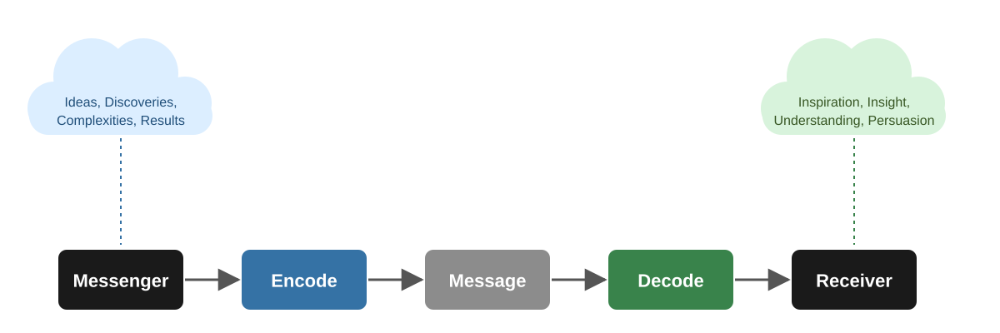
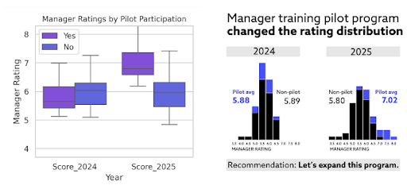
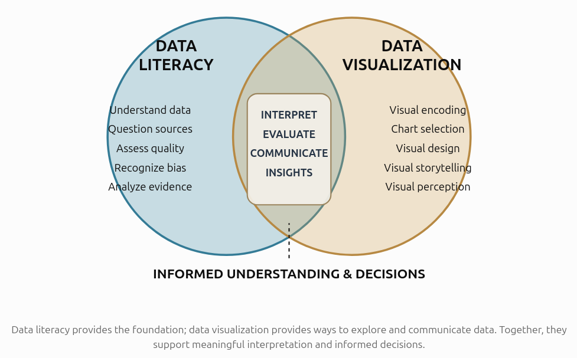
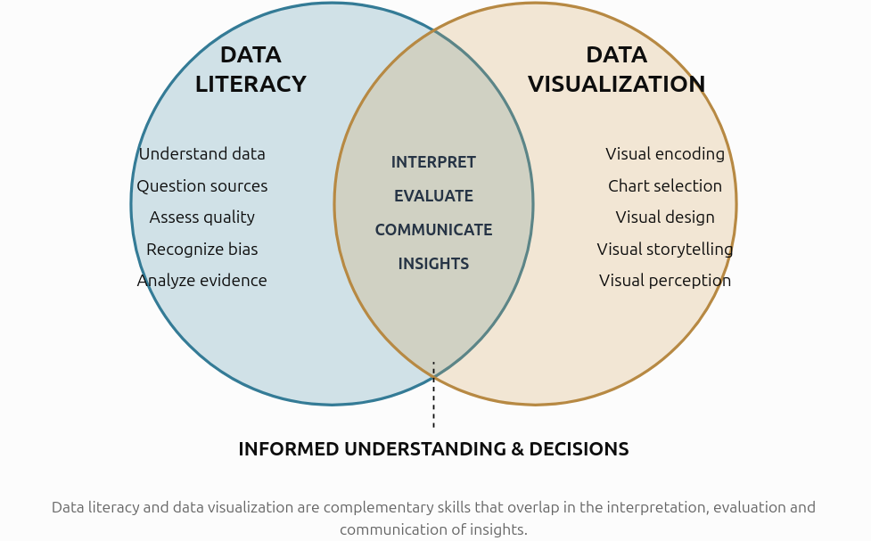
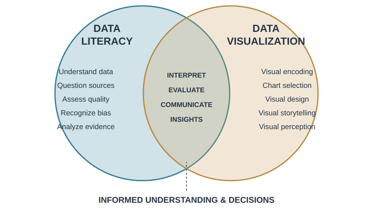
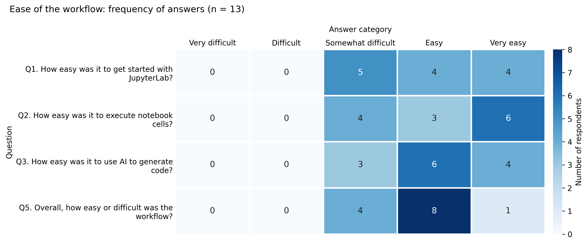

<style>
.reveal {
  font-size: 40px;
}

.reveal h1 {
  font-size: 2.1em;
  font-weight: 700;
  letter-spacing: -0.03em;
}

.reveal h2 {
  font-size: 1.55em;
  font-weight: 650;
  letter-spacing: -0.02em;
}

.reveal h3 {
  font-size: 1.1em;
  font-weight: 650;
}

.reveal p {
  line-height: 1.4;
}

.reveal li {
  margin-bottom: 0.45em;
  line-height: 1.35;
}

.reveal blockquote {
  width: 90%;
  padding: 0.5em 0.8em;
  border-left: 5px solid #3572a5;
  background: #f3f6fa;
  color: #333;
  font-style: italic;
  box-shadow: none;
}

.reveal .callout {
  font-size: 0.85em;
}

.reveal .columns {
  align-items: stretch;
}

.reveal .column {
  padding: 0.5em;
}

.reveal .fragment {
  margin-top: 0.3em;
}

.reveal .mermaid {
  font-size: 0.8em;
}

.reveal a {
  color: #3572a5;
}

.reveal .slide-number {
  font-size: 0.6em;
}

.reveal section {
  text-align: left;
}

.reveal section.center,
.reveal section.title-slide {
  text-align: center;
}

.reveal strong {
  color: #245b87;
}

.reveal .callout-important {
  border-left-color: #c18b20;
}
</style>

---

## What is data visualization?

> Data visualization is the graphical representation of quantitative and qualitative information.

But why do we visualize data?


- **Explore:** Discover patterns, trends, and relationships.

- **Validate:** Assess assumptions and the validity of a model.

- **Communicate:** Explain findings and support decision-making.

- **Understand:** Make complex information accessible.


---

## How can Visualization be Useful?

Anscombe's quartet: same statistics, different data

```{r}
#| echo: false
#| fig-width: 9
#| fig-height: 4.5
library(ggplot2)

q <- data.frame(set = factor(rep(1:4, each = 11)),
                x = unlist(anscombe[paste0("x", 1:4)]),
                y = unlist(anscombe[paste0("y", 1:4)]))

lab <- sapply(1:4, function(i) {
  cf <- coef(lm(y ~ x, data = q[q$set == i, ]))
  sprintf("x%d-y%d data\ny = %.4fx + %.4f", i, i, cf[2], cf[1])
})

ggplot(q, aes(x, y)) +
  geom_point(color = "blue", size = 2.5) +
  geom_smooth(method = "lm", se = FALSE, color = "black") +
  facet_wrap(~ set, ncol = 2, labeller = labeller(set = setNames(lab, 1:4))) +
  theme_bw()
```

---

## The Visualization Pipeline: A Communication View

{fig-align="center" width=1000px}


---

## When do we have a good visualization?

Simple in theory ...

> When the targeted users can easily accomplish what they want using the visualization


In practice, complicated ...

> - Can the audience identify the main message?
> - Is the level of detail appropriate?
> - Is the visual representation appropriate for the data?
> - How much cognitive effort is required?
> - Does the visualization support the intended task?

---

## AI vs. humans

{fig-align="center" width=800px}

::: aside
- [Knaflic, C. N. (2026, April 23). Data storytelling in the age of AI: what humans still do best. Storytelling with Data](https://www.storytellingwithdata.com/blog/data-storytelling-in-the-age-of-ai)
:::

---

## AI can make your charts. It may not make them work

{fig-align="center" width=700px}

::: aside
- [(2026, June 3). AI can make your charts. It may not make them work](https://thevisualagency.com/tva-blog-articles/ai-can-make-your-charts-it-may-not-make-them-work/)
:::

---

## Main restrictions

- Communication
- Legal
- Cost

---


## The text-only interface as a fundamental bottleneck

> Sometimes you don't have the vocabulary to describe what you envision.

You might imagine:

- A particular spatial arrangement.
- A specific visual relationship.
- An interaction between multiple elements.
- A composition that communicates a particular idea.

But you might not know the terminology required to describe it.

---

## Asking the right questions

> To ask the right question is already half the solution of a problem.

— Carl Jung (attributed)

---

## A simple task for AI (1)

{fig-align="center" width=1000px}

---

## A simple task for AI (2)

> Fix the text to fit inside the circle.

{fig-align="center" width=1000px}

---

## A simple task for AI (3)

> Part of the text is still outside the circle. Fix it and provide the code.

{fig-align="center" width=1000px}

---

## A simple task for the human

> Key takeaway: learn the fundamentals.

{fig-align="center" width=1000px}

---

## AI data restrictions to generate visualizations


- **Volume:** Upload limits, context windows, processing time.
- **Cost:** API usage, tokens, computational resources.
- **Privacy:** Personal and sensitive information (GDPR).
- **Confidentiality:** Unpublished research and institutional data.
- **Ownership:** Licensing and intellectual property.
- **Security:** Storage, retention, access and data transfers.

---

## USE CASE

> Teaching practical data visualization for PhD students

Consider that students have different:

- backgrounds and skills
- data
- interests
- hardware
- Operating systems

---

## How can we help students benefit from AI to create their own visualizations?

> Assume that they do not have programming skills

---

## Materials and Methods

- Standardized environment in a computer cluster
- Data
- Jupyterlab Notebooks
- Notebook template
- Considering that AI is very good at languages, programming languages should not be problem
- We can ask AI to write the code so that we can copy and paste it in cells

---

## What AI needs to create the code

> Metadata about the data

- Structure of the data, `rows`, `columns`
- Column names,
- Data types
- Summary statistics
- Null values

> Main goal of the visualization

- Type of chart
- The Mapping of variables in to marks (aesthetics)

---

## Template Notebook: Load the Data
<br>
<br>
```python

# 🟨 STUDENT INPUT — set the path to your data file, then run this cell (Shift + Enter)
file_path = "your_data.csv"

# ▶️ RUN — load the required packages and read the file
import pandas as pd

# For a CSV file:
df = pd.read_csv(file_path)


print("Dataset loaded in the 'df' dataframe")
```

---

## Template Notebook: Explore the dataset (Metadata)

<br>
<br>

```python

# ▶️ RUN — explore the dataset
print("First 5 rows:")
display(df.head())

print("\nRows and columns:", df.shape)

print("\nColumn names:", df.columns.tolist())

print("\nData types and non-null counts:")
df.info()

print("\nSummary statistics:")
display(df.describe(include="all").T)

print("\nMissing values per column:")
display(df.isna().sum().to_frame("missing_values"))
```

---

## Template Notebook: Prompt to prepare the data

<br>
<br>

```text
Given my research question/goal "[YOUR RESEARCH QUESTION/GOAL]"

and my dataframe "df" with the following structure


[PASTE HERE the output of the exploration cell in section 3]


propose the minimum data-preparation steps and provide the python code. 
Explain why each step is needed. Do not remove or alter observations without explaining the consequences.
```

<br>

```md
# 🟩 Paste the data-preparation code returned by the AI here,
# read it, and run the cell (Shift + Enter).
```

---

## Template Notebook: Prompt to Choose a Visualizaion

<br><br>

```md
🟦 COPY → AI (edit, then copy this whole cell and paste it into your AI chat)

Given my research question "[YOUR RESEARCH QUESTION]"

and my prepared dataframe 'data' with the following checks and structure

"""
[PASTE HERE the output of the preparation cell in section 4]
"""

Recommend suitable chart types for this research question and these variables. 
Compare their strengths and limitations. 
Consider the measurement scales and whether the data are ordered, categorical, or continuous. 
Do not create the chart yet.
```

---

## Template Notebook: Prompt to create the first visualization

<br><br>


```md
🟦 COPY → AI (edit, then copy this whole cell and paste it into your AI chat)

Write Python code for the [CHOSEN CHART TYPE]. 

Use my existing dataframe named `data` and these exact columns: [COLUMN NAMES].
 Include a descriptive title, axis labels with units, and an appropriate legend if needed. 
 
 Explain the code and flag assumptions.
```


---

## Minimal training for students

- How to login into the cluster and start JupyterLab
- Explanation about what JupyterLab is
- Explanation about what a Notebook is
- Explantion about cells and how to run them

---

## Visualization tasks

::: {.callout-note appearance="simple" title="Task 1"}
- Transform the data from long to wide format
- Normalize the data
- Create a histogram
:::

::: {.callout-tip appearance="simple" title="Task 2"}
- Reproduce a disease plot
- Merge 2 datasets
- Create an interactive heatmap
:::

::: {.callout-important appearance="simple" title="Task 3"}
- Select a chart from the *Fundamentals of Data Visualization* book, by Claus O. Wilke
- Render the chapter and save the data for later use
- Ask AI to rewrite the code in Python and Plotly
:::

---

## TASK 1: Preliminary Results



---

## Programming experience vs. ease of workflow


<div style="display:flex; justify-content:center;">
  <iframe src="images/parcats_jupyterlab.html" width="1200" height="800"
          style="border:none;"></iframe>
</div> 

---

## Student Feedback: Key Takeaways

- **User-friendly environment**
  - Hábrók is easy to use.
  - File upload and download are convenient.

- **Clearer instructions**
  - Explain file paths and working directories.
  - Provide more guidance for beginners.
  - Improve visual separation between sections.

- **Positive learning experience**
  - AI helps explain errors and generate code.
  - Always verify AI suggestions against actual results.

---

## Preliminary Experiment Takeaways

- **Notebooks are promising for teaching data visalization**
- **Most of the students succeeded to conclude the tasks**
- **Given a proper context, AI generates code that works**

---

## Implications for data visualization education

If AI handles more of the coding, should we spend less time learning?


> In fact, the opposite may be true.

### More theory, less mechanical practice

- Learn principles of human visual perception.
- Study visual encoding and representation.
- Learn to evaluate and critique visualizations.

::: {.callout-important}
**Understanding design principles becomes more important, not less, because these principles enable us to supervise AI effectively and challenge inefective outputs.**
:::

---

## Thank you!

::: {.absolute top="35%" left="15%" right="15%" style="text-align: center;"}

**The future belongs not to those who can generate the most answers, but to those who know how to ask the right questions.**

:::


